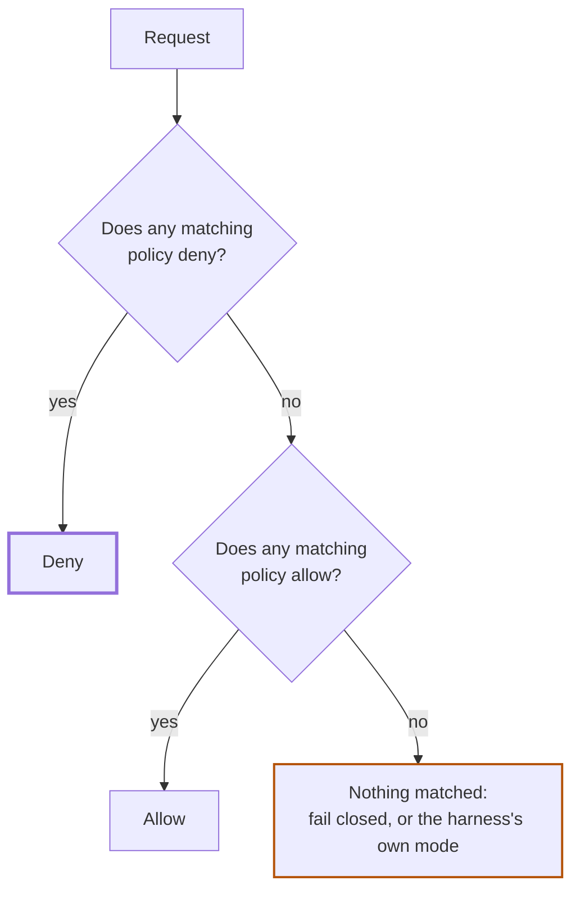

# Policy priority and precedence

Kei decides with **deny-overrides**, and policies no longer have a priority. This page keeps its old address; the full reference is **[How Kei decides](/kei/reference/how-kei-decides)**.

## Summary

- When several enabled policies match a request, any matching deny wins, however many allows also match and whatever order the policies were created in.
- If no policy denies and at least one allow matches, the request is allowed.
- If no enabled policy matches, desktop harnesses use their native mode (usually ask); SDK and connector calls fail closed.
- To make an exception to a broad allow, add a narrower deny. There is no priority to set.

*The member deny covers an overlapping engineering grant.*

See [How Kei decides](/kei/reference/how-kei-decides) for worked examples and the comparison with the earlier priority model.
