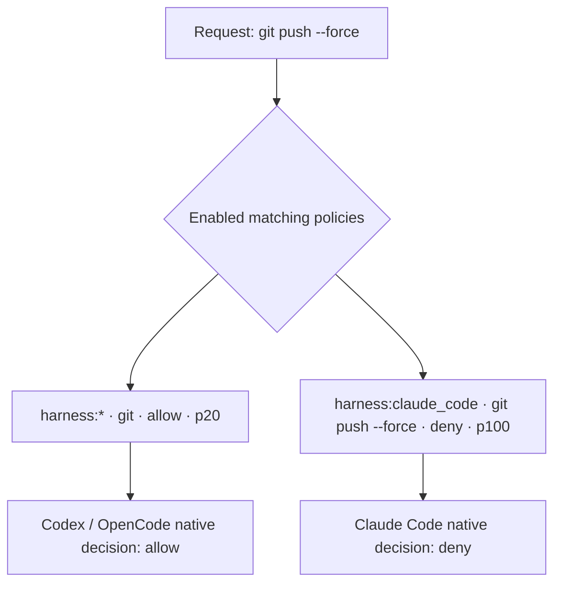
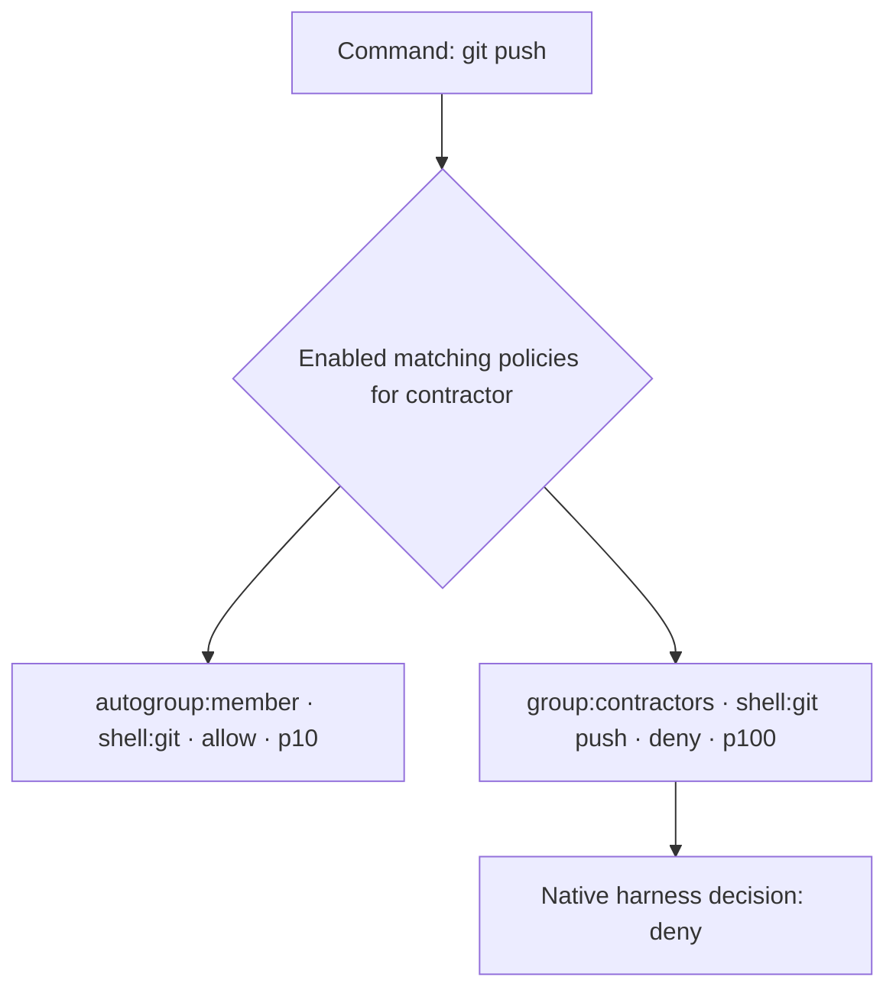
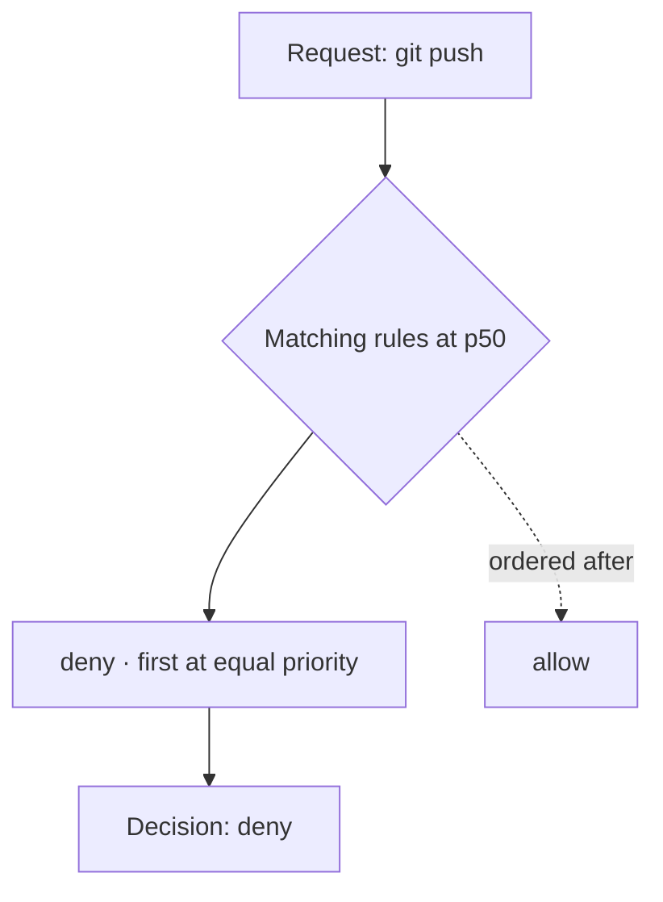
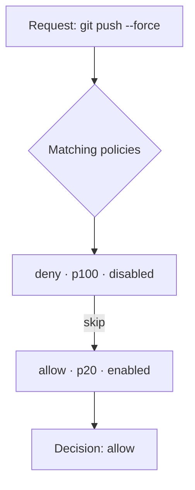
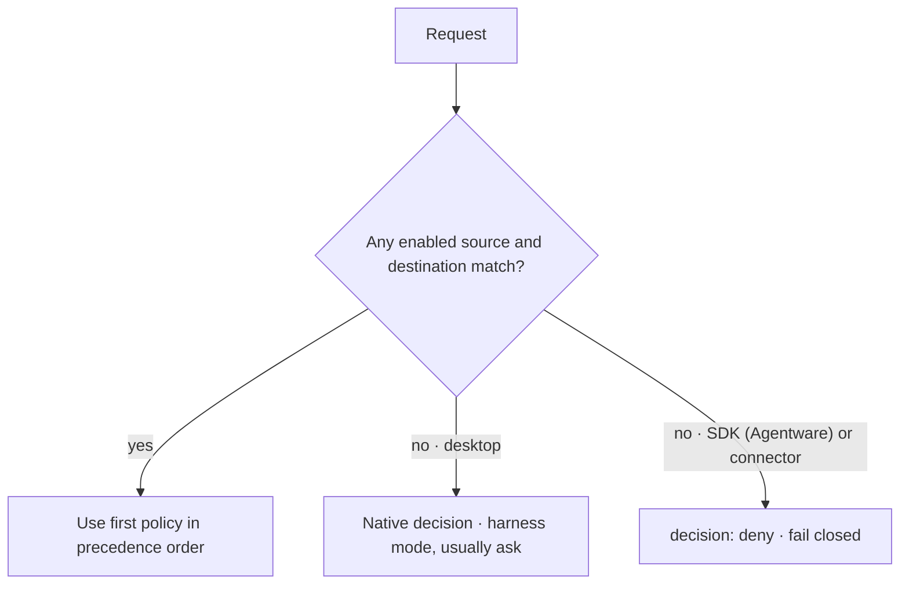

# How Kei decides: policy priority and precedence

When several enabled policies match the same request, Kei uses priority and policy effect to determine the evaluation decision. The effect and resulting decision are allow or deny. Desktop harnesses also make their own **native decision** from their local permission settings.

The API and CLI accept `permit` as the stored API and CLI value for an allow.

## Anatomy of a policy

Each policy has a source (`src`), destination (`dst`), effect, priority, and enabled state.

| Field | What it means | Examples | Where it's decided |
| --- | --- | --- | --- |
| `src` | Who the policy applies to: `*`, `harness:*`, `harness:<kind>` or `harness:<id>`, `agent:<id>`, `group:<name>`, `user:<id>`, `email:<address>`, or `org:<role>` | `group:developers`, `harness:claude_code`, `email:person@example.com` | Checked against the request's authenticated identity and workspace |
| `dst` | What it matches: `shell:<prefix>`, `skill:<name>`, `path:<glob>`, `tool:<name>`, `capability:<name>`, `resource:<name>`, or `connector:<id>` | `shell:git push`, `skill:wiki`, `path:/repo/**`, `tool:registered_function`, `capability:pull_request.read`, `resource:pull_request:174`, `connector:issues-service` | Shell, skill, and path effects render into Claude Code, Codex, and OpenCode native settings. Tool-call, capability, resource, and connector targets are evaluated by `kei-proxy authorize` for SDK (Agentware) integrations and connector operations; registered `tool:<kind>.<name>` harness targets use native settings. Unmatched runtime requests fail closed. |
| `effect` | A policy's outcome if it decides: allow or deny | `deny` | Used to produce an evaluation decision, or rendered into native settings for shell, skill, and path policies |
| `priority` | An integer weight. A higher number wins. | `100` | Used to order matching Kei policies |
| `enabled` | Whether the policy participates in a decision | `true` or `false` | Disabled policies are skipped |

`*` and `harness:*` match all sources and harnesses, respectively. A `harness:<kind>` source names one harness kind, such as `harness:claude_code`.

Policy identity is resolved from the authenticated session and scoped to its workspace. `user:<id>` uses the stable Kei user ID; `email:<address>` is a legacy source form and is matched against the email associated with that resolved user, never an email supplied by the caller.

For prebuilt desktop command policies, a `*` source renders for every harness, and a `harness:` source renders for the harness it names. A `user:` or `email:` source renders when it matches the policy bundle's subject, and a `group:` source renders when it matches one of that subject's groups. When such a source does not match, its policy is skipped, and a lower-precedence allow it overlaps is withheld so the harness asks; a skipped deny never becomes an allow. See [Create policies](/content/kei/policies/create-policies.html#what-renders-into-a-desktop-harness) for a worked example. A `tool:<kind>.<name>` target can also name a registered native harness tool (for example, `tool:claude_code.edit`); the harness renderer handles that target. Tool-call targets such as `tool:registered_function` in the examples below are evaluated by `kei-proxy authorize`.

Groups are scoped to a workspace. Members of a group also get everything granted to the groups it inherits from. Group cycles are rejected when groups are updated, nesting cannot cross workspace boundaries, and the maximum nesting depth is bounded; runtime evaluation fails closed if that bound is exceeded. The `autogroup:member` source resolves at runtime for every organization member and is never stored as a group or membership.

## How a decision is made

For a request, Kei first collects enabled policies whose source applies and whose destination matches. It then orders those policies by:

1. Priority, highest first.
2. Effect, with deny before allow at the same priority.
3. Policy ID, ascending, as the final deterministic tie-breaker.

The first policy in that order determines the evaluation decision. For `kei-proxy authorize`, the runtime evaluates its current, verified, versioned policy bundle locally; updates refresh in the background. If the bundle expires or cannot be validated, the runtime fails closed. If no enabled policy matches, SDK (Agentware) integrations and connector operations receive a `deny` decision.

Desktop shell, skill, and path policy effects render into local harness settings. When there is no rendered rule, the harness makes its own **native decision**, using its configured permissions and permission mode (usually **ask**). The audit hook reports tool activity; it does not make a decision or block a call. An access approval grants user or group access for future calls; a call does not pause for per-call approval.

A tool call can declare `required_capabilities`, which are combined with AND: every required capability must have an allow decision for the tool call to proceed. A tool-call allow never overrides a deny effect on one of those capabilities. Precedence is evaluated separately for each capability, and the combined result is allow only when every required capability is allowed.

## Matching rules

- **Shell:** a whole-token argv prefix. `shell:git` matches `git push`, but not `gitx`; each policy token must match the corresponding command token exactly. There is no quoting, escaping, or partial-token slash match.
- **Path:** a glob for an absolute, lexically cleaned path. `*` matches within one path segment and `**` as a whole segment matches zero or more path segments; for example, `path:/repo/**` matches paths under `/repo`.
- **Skill:** exact name. `skill:wiki` matches `wiki`, not `wiki-admin`.
- **Tool:** exact tool-call name, with no wildcards and no `:` inside the name. For example, `tool:registered_function` matches only the named registered tool call. The same exact-match rule applies to other registered tool names.
- **Capability:** exact capability name, with no wildcards. For example, `capability:pull_request.read` matches only that capability.
- **Resource:** an exact resource target, such as `resource:pull_request:174`.
- **Connector:** `connector:*` matches any non-empty connector ID. A `*` inside a name is literal; for example, `connector:issues.*` matches that literal connector ID, not every connector beginning with `issues`.

## Worked examples

### A. A narrow Claude Code deny overrides a harness-wide allow

The harness-wide allow applies to Claude Code, Codex, and OpenCode. The higher-priority, more specific deny blocks the force-push prefix on Claude Code. A `harness:` source is optional; people and agents are the normal sources, and group-based tool and capability policies are evaluated by `kei-proxy authorize`.

| Source | Destination | Effect | Priority | Applies to |
| --- | --- | --- | ---: | --- |
| `harness:*` | `shell:git` | allow | 20 | Claude Code, Codex, and OpenCode |
| `harness:claude_code` | `shell:git push --force` | deny | 100 | Claude Code |

### B. A narrow shell deny overrides a member baseline

The `autogroup:member` source applies to every organization member. The baseline allows `git` commands, while the higher-priority contractors deny blocks `git push` for members of the contractors group.

The broader allow covers `git` commands, but the higher-priority deny blocks `git push` for contractors. Other organization members can still run `git push`, and contractors can still run other `git` commands.

| Source | Destination | Effect | Priority | Applies to |
| --- | --- | --- | ---: | --- |
| `autogroup:member` | `shell:git` | allow | 10 | Everyone |
| `group:contractors` | `shell:git push` | deny | 100 | Contractors |

### C. Deny wins an equal-priority tie

If both matching rules have priority `50`, the deny is ordered first and decides the request.

| Source | Destination | Effect | Priority |
| --- | --- | --- | ---: |
| `harness:*` | `shell:git push` | allow | 50 |
| `harness:*` | `shell:git push` | deny | 50 |

### D. Disabled rules are skipped

The disabled priority `100` deny does not participate. The enabled priority `20` allow is the first matching rule and decides.

| Source | Destination | Effect | Priority | Enabled |
| --- | --- | --- | ---: | --- |
| `harness:*` | `shell:git push --force` | deny | 100 | no |
| `harness:*` | `shell:git` | allow | 20 | yes |

### E. No match uses the harness default

When no enabled policy matches the source and destination, there is no matching policy effect. A desktop harness makes its own native decision using its permission mode (usually ask). An SDK (Agentware) integration or connector operation receives a `deny` decision by default. Pi and Open WebUI use their own integrations.

| Request | Matching policy | Result |
| --- | --- | --- |
| `shell:deploy-prod` on Claude Code | None | Native decision from Claude Code's configured mode, usually ask |
| `connector:billing.charge` through a connector | None | `deny` decision (fail closed) |

## Choosing priorities

**RECOMMENDED convention (a suggestion, not enforced):** use `100` for guardrail denies, `50` for harness-wide allows, `20` for role or group allows, and `10` for the baseline (`autogroup:member`). Leave gaps so you can insert rules later. When the order matters, give each rule a distinct priority instead of relying on the policy ID tie-breaker.

## Where you see precedence

- **Policies:** switch to the group view to see rules in precedence order. An `except` note shows a narrower rule that changes where a broader rule applies; `Never applies` means a winning rule always supersedes that rule for its match. When the override is harness-scoped, the note names the harness.
- **Group detail:** the **Effective** tab shows inherited and direct policies in effective precedence order.
- **Audit Logs:** **Decided by** identifies the winning policy, and **Outranked** lists matching policies that lost or were disabled. Audit events retain decision metadata and tool names; see [Audit tool-argument encryption](/content/kei/audit/encryption.html) for how call arguments are handled and encrypted when customer keys are configured.

Policy bundles are issued per runtime installation and workspace, so each installation evaluates the policies for its workspace.

For desktop harnesses, Kei renders shell, skill, and path policy effects into native rules: Claude Code gives deny entries precedence over allow entries, Codex represents deny entries as `forbidden`, and OpenCode writes bash entries in its permission configuration. The harness uses those settings to make its own **native decision**. Its hook is report-only. See [Create policies](/content/kei/policies/create-policies.html), [Policies and approvals](/content/kei/policies/policies-and-approvals.html), [How Kei governs coding agents](/content/kei/reference/how-it-works.html), and [Run your own harness with Kei permissions](/content/kei/connect-your-harness/harness-setup.html) for setup and policy context.

## See also

- [Deterministic guardrails: how Kei compares with other policy models](/content/kei/reference/deterministic-guardrails.html)
