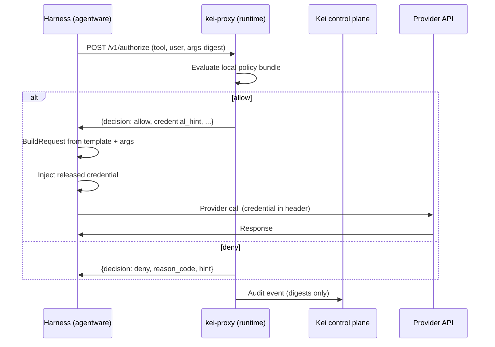
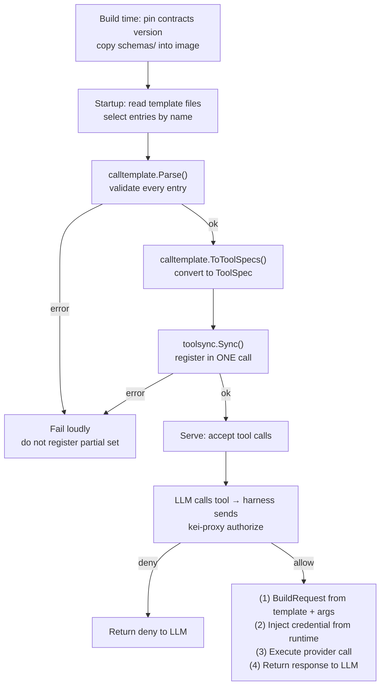

# Contracts, Agentware, and how to build a custom connector

Kei governs agent tool calls through three layers that serve different roles:

- **kei-connector-contracts** is the platform specification — the canonical
  schemas and validators that define what a tool definition looks like, which
  operations a connector exposes, and what a harness must send to get an
  allow or deny from the runtime.
- **Agentware** is the SDK that implements the specification — it imports
  contracts, validates tool call templates, registers tools in one sync, and
  builds the provider HTTP call after the runtime allows it.
- **The runtime (`kei-proxy`)** is decision-only: it authorizes, passes
  credentials through, and audits. It never executes a provider call or stores
  provider data (ADR-039).

This page explains the split, where each layer lives, when you use one versus
the other, and walks through a complete custom-connector example.

## Contents

- [Contract vs SDK vs runtime](#contract-vs-sdk-vs-runtime)
- [kei-connector-contracts: the platform specification](#kei-connector-contracts-the-platform-specification)
- [Agentware: the SDK and engine](#agentware-the-sdk-and-engine)
- [The runtime is decision-only](#the-runtime-is-decision-only)
- [The providers package: when to use it versus a template](#the-providers-package-when-to-use-it-versus-a-template)
- [Worked example: a custom connector end to end](#worked-example-a-custom-connector-end-to-end)

## Contract vs SDK vs runtime

| Layer | Repository | What it is | Who uses it |
|-------|-----------|------------|-------------|
| **Contracts** | `github.com/HaikeiLabs/kei-connector-contracts` | Platform spec: tool definition schemas, call template validator, capability declarations, provider client interfaces, conformance tests | Every harness that goes through the runtime must meet this contract. The catalog uses it as a spec library. |
| **Agentware** | `github.com/HaikeiLabs/agentware` | SDK and generic engine: imports contracts, validates templates, converts them to tool registrations, builds provider requests after an allow, syncs tool manifests | Harness developers who add Kei governance to a custom agent. |
| **Runtime** | `github.com/HaikeiLabs/kei-connector-runtime` | `kei-proxy` — the local decision point (authorize, credential pass-through, audit). No provider calls, no data storage. | Every agent installation on a developer machine or server. |

## kei-connector-contracts: the platform specification

The contracts repository (`kei-connector-contracts`) is the authoritative
definition of **what a governed tool call looks like**. It contains:

- **JSON Schemas** for tool definitions
  (`schemas/tool-definition.v1.schema.json`) and the stricter tool-call
  template profile (`schemas/tool-call-template.v1.schema.json`).
- **Shipped tool definitions** for every built-in connector
  (`schemas/*.tool-definition.v1.json`) — Linear, GitHub, Google Drive,
  Notion, Discord, Grafana, `http_api`, and more.
- **The `calltemplate` package** — a Go validator that reads a template file
  and returns every problem in one joined error. It checks for valid names,
  closed parameter schemas, correct transport metadata, and — critically —
  that no secret value or placeholder-impersonating credential has been
  embedded in the template.
- **The `schemas` package** — embeds all shipped schemas and tool definitions
  in an `embed.FS` so harnesses can load them without filesystem paths:

  ```go
  import "github.com/HaikeiLabs/kei-connector-contracts/schemas"

  data, _ := schemas.FS.ReadFile("github.tool-definition.v1.json")
  templates, err := calltemplate.Parse(data)
  ```

- **Capability declarations** — every connector operation maps to a named
  capability such as `issue.read`, `pull_request.write`, or `file.search`.
  The `contract` package defines the capability structure and the
  `ValidateCall` gate.
- **The `providers` package** — a stable, harness-consumable Go library of
  connector clients (see [its own section below](#the-providers-package-when-to-use-it-versus-a-template)).
- **Conformance tests** — `calltemplate/calltemplate_test.go` and
  `conformance/tool_call_templates_test.go` pin the schemas, permissions,
  and transport fields against the hand-written definitions they replace.

A harness pins a contracts version into its image at build time (the same way
it pins `kei-proxy.version`). At startup it reads the template files it needs,
validates them, and either proceeds or aborts loudly. A template that fails
validation is a startup error — the harness must not register a partial set.

### Tool call template profile {#tool-call-template-profile}

A **tool call template** is a `kei.tool-definition/v1` entry read under the
stricter `tool-call-template.v1.schema.json` profile. Every template must:

1. Carry a tool schema in `parameters` — either a list of named parameters or
   a JSON Schema object with `type: object`, `additionalProperties: false`,
   and every `required` name present in `properties`.
2. Have a `permission`, `description`, a unique `name`, and no unknown fields.
3. If `binding.transport` is present: a valid HTTP method, a `url_template`,
   valid `auth.placement`, and every `{placeholder}` in the URL template
   covered by an `args` entry with `in: path`.
4. Contain **no secret** — no token-shaped values, no literal `Bearer`/`Basic`
   credential, no `user:pass@` in a URL, no secret-named key holding a literal
   value.

The Go validator (`calltemplate.Parse` or `calltemplate.LoadFile`) enforces
all of this plus the secret checks that JSON Schema cannot express.

### How a harness imports and uses templates

1. **Build time:** pin a contracts version (a git tag) in the image, for
   example a `kei-connector-contracts.version` file next to `kei-proxy.version`,
   and copy `schemas/` from that tag into the image.
2. **Startup:** for each function the harness runs, name the tools it needs.
   Read the matching `schemas/<connector>.tool-definition.v1.json` files and
   select entries by `name`. A missing name is a startup error.
3. **Validate:** call `calltemplate.Parse(data)` or
   `calltemplate.LoadFile(path)`. Every problem is reported in one joined
   error — fix all of them before proceeding.
4. **Register:** convert the validated templates to tool specifications and
   sync them to Kei in **one** registration. Any validation or sync error
   aborts startup loudly.
5. **After an allow:** look up the template by tool name, fill `url_template`
   placeholders and `args` from the tool arguments, apply any encoding
   (for example `base64`), then inject the credential that the runtime
   released at the `auth.placement` / `auth.name` / `auth.scheme` the
   template declares. The template itself never holds a credential.

## Agentware: the SDK and engine

The [Agentware SDK](https://github.com/HaikeiLabs/agentware) wraps
kei-connector-contracts so that harnesses import only agentware types and
never depend on contracts directly. It provides the generic engine that:

1. **Validates and loads tool call templates** — `calltemplate.Parse`,
   `LoadFile`, and `ParseFS` are thin wrappers over the contracts package.
   The public API exposes only agentware types (`calltemplate.Template`,
   `calltemplate.Binding`, etc.):

   ```go
   import "github.com/haikeilabs/agentware/go/kei/calltemplate"

   tpls, err := calltemplate.Parse(data)
   // or from an fs.FS:
   tpls, err := calltemplate.ParseFS(schemas.FS, "linear.tool-definition.v1.json")
   ```

2. **Converts templates to tool registrations in one sync** —
   `calltemplate.ToToolSpecs` converts validated templates to
   `[]toolspec.ToolSpec`, ready for one-shot manifest registration through
   `toolsync.Sync` or `SocketRegistrar.Send`. Each template becomes a
   connector-bound tool with the required capabilities derived from its
   `permission` field:

   ```go
   specs, err := calltemplate.ToToolSpecs(tpls, "my-agent-id")
   // specs is []toolspec.ToolSpec — send it through toolsync.Sync()
   ```

3. **Builds the provider call after an allow** — `calltemplate.BuildRequest`
   takes a validated template and the tool call arguments (as the LLM
   provided them) and returns a `ProviderRequest` with placeholders filled,
   query parameters set, headers populated, and the body constructed with any
   required encoding. The credential is **never** included — it is injected
   by the harness after the allow decision:

   ```go
   req, err := calltemplate.BuildRequest(tpl, args)
   // req.Method, req.URL, req.Headers, req.Body are ready.
   // The harness adds the credential header from the released token.
   ```

4. **Syncs the tool manifest** — `toolsync.Sync` sends the tool manifest to
   the Kei control plane (`PUT /api/v1/runtime/tools`). It retries with
   exponential backoff and fails closed if registration fails:

   ```go
   import "github.com/haikeilabs/agentware/go/kei/toolsync"

   cfg, _ := toolsync.ConfigFromEnv(nil) // reads KEI_RUNTIME_* variables
   result, err := toolsync.Sync(ctx, manifest, cfg, true)
   ```

   The `SocketRegistrar` does the same over a local runtime socket
   (`POST /v1/tools:register`).

Agentware ships in **Go**, **Python**, and **TypeScript**. Each language
provides a `KeiProxyEvaluator` over `kei-proxy authorize`. The language
guides are at [Build on Agentware](/agentware/build/overview).

### Why not import contracts directly? {#why-not-import-contracts-directly}

Agentware re-exports the contracts types so that a custom connector author
needs **only the agentware dependency**. The agentware API must not expose
contracts types as required imports — nothing generic may mention a specific
connector. A harness that uses agentware never adds
`github.com/HaikeiLabs/kei-connector-contracts` to its `go.mod`. The type
aliases are transparent: `calltemplate.Template` is literally
`contracts.Template`, but the import path stays agentware.

## The runtime is decision-only

The `kei-proxy` binary (kei-connector-runtime) implements ADR-039: it is a
**decision-only enforcement point**. It:

- **Authorizes** tool calls via `kei-proxy authorize` — evaluating the local
  policy bundle against the caller identity, requested tool, action, and
  resource. Returns allow or deny with a `reason_code` and optional `hint`.
- **Passes credentials through** — for OAuth connectors the catalog proxies
  the access token to the runtime (in memory, for one call). For
  secret-backed connectors the runtime resolves the credential from the
  configured secret manager. The credential is released to the harness only
  after an allow.
- **Audits** — emits redacted audit records (digests only, no payloads, no
  credentials) to the `KEI_PROXY_AUDIT` JSONL file for collection and upload.

The runtime **never** executes a provider call, stores provider data, or
routes MCP calls (HAI-724 removes `/mcp` routing). Provider execution is the
harness's responsibility — agentware's `BuildRequest` helps the harness build
the call, but the runtime itself only decides.

### The authorize flow



The runtime evaluates policy **locally** — it caches the signed, versioned
policy bundle and never calls the control plane for the hot-path decision.
Only credential release and audit upload are online operations.

## The providers package: when to use it versus a template

The `providers` package in `kei-connector-contracts` is a **stable,
harness-consumable Go library** of governed connector clients (ADR-036
section 9.2). It is **kept, not retired** — the owner confirmed this on
2026-10-24. HAI-724 deletes the runtime executors that imported it, but the
package itself and its two `kei` CLI users stay.

### What the providers package is

Each provider constructor takes a `CredentialResolver` and an `*http.Client`
and returns a client bound to the provider's fixed base endpoint. The client
resolves no credential on its own and never imports `kei-connector-runtime`:

```go
import "github.com/HaikeiLabs/kei-connector-contracts/providers"

client, _ := providers.New(contract.ProviderGitHub)
result, err := client.Invoke(ctx, meta, inv, payload)
```

The `providers.Client` interface is the provider-neutral seam. Every
connector — GitHub, Linear, Google Drive, Gmail, Discord, Grafana, Notion,
Tito, CRM, `http_api`, `skills_repo` — implements it.

### When to use providers versus a template

| Use case | Recommended approach |
|----------|---------------------|
| Your harness is written in **Go** and needs a full typed client with structured results and typed errors | Use `providers` directly. Import `github.com/HaikeiLabs/kei-connector-contracts/providers`. |
| Your harness needs to describe a provider call as **HTTP transport metadata** (method, URL template, auth placement, args mapping) | Use a **tool call template**. The same file registers the tool and drives the call. Works in Go, Python, TypeScript. |
| You are writing a **custom connector** for a REST API that has no built-in provider client | Write a **tool call template**. No Go client code needed. |
| You need a **language other than Go** | Templates work everywhere. `providers` is Go-only. |
| You need **fine-grained redaction** or **capability-specific result shaping** that the built-in provider clients handle | Use `providers` — the redaction is built into each client. For a template, the harness does the redaction. |

Both approaches are valid. Templates are **additive** — they do not deprecate
or replace `providers`. The agentware template engine (`BuildRequest`) is an
alternative path that does not require a Go client per provider.

### How templates and providers relate

For a provider that already has a `providers` client (like Linear), a template
describes the same operation as HTTP metadata. The template says "send a POST
to `https://api.linear.app/graphql` with these body fields"; the `providers`
package says "call `linear.New(...)` then `client.Invoke(...)`". Both hit the
same API — one through a generic HTTP builder, the other through a typed Go
client. A harness can use either, or both for different operations.

## Worked example: a custom connector end to end

This example builds a **custom connector** for a fictional
`statuspage.io`-style API. It defines one tool (`statuspage.list_incidents`),
validates it, registers it, and builds the provider call after an allow. Every
command shown below has been verified against the real agentware and contracts
code.

### 1. Write the tool definition

Create a file `schemas/statuspage.tool-definition.v1.json`:

```json title="schemas/statuspage.tool-definition.v1.json"
[
  {
    "schema": "kei.tool-definition/v1",
    "name": "statuspage.list_incidents",
    "description": "List current incidents from the governed Statuspage",
    "parameters": [
      {
        "name": "page",
        "description": "Page number (starts at 1)",
        "type": "integer",
        "required": false,
        "default": 1
      },
      {
        "name": "per_page",
        "description": "Incidents per page",
        "type": "integer",
        "required": false,
        "default": 25
      }
    ],
    "permission": "statuspage.read",
    "category": "statuspage",
    "service": "statuspage",
    "version": "1.0.0",
    "tags": ["incidents-read", "governed-connector"],
    "binding": {
      "connector_id": "conn_statuspage_1",
      "transport": {
        "method": "GET",
        "url_template": "https://api.statuspage.io/v1/pages/{page_id}/incidents",
        "auth": {
          "placement": "header",
          "name": "Authorization",
          "scheme": "OAuth"
        },
        "args": {
          "page_id": {
            "in": "path"
          },
          "page": {
            "in": "query",
            "name": "page"
          },
          "per_page": {
            "in": "query",
            "name": "per_page"
          }
        }
      }
    }
  }
]
```

The template declares:

- A permission gate (`statuspage.read`) that the policy bundle checks
- An HTTP GET to `https://api.statuspage.io/v1/pages/{page_id}/incidents`
- Two query parameters (`page`, `per_page`) mapped from tool arguments
- An auth placement — the harness injects the credential into the
  `Authorization: OAuth <token>` header after the allow. The template
  holds only the placement metadata, never the credential value.

### 2. Validate the template

With the agentware Go SDK:

```go
package main

import (
    "fmt"
    "os"

    "github.com/haikeilabs/agentware/go/kei/calltemplate"
)

func main() {
    data, err := os.ReadFile("schemas/statuspage.tool-definition.v1.json")
    if err != nil {
        fmt.Fprintf(os.Stderr, "error reading file: %v\n", err)
        os.Exit(1)
    }

    tpls, err := calltemplate.Parse(data)
    if err != nil {
        // Every problem is reported in one joined error.
        fmt.Fprintf(os.Stderr, "validation failed:\n%v\n", err)
        os.Exit(1)
    }

    fmt.Printf("Validated %d templates:\n", len(tpls))
    for _, t := range tpls {
        fmt.Printf("  - %s (%s)\n", t.Name, t.Description)
    }
}
```

Output:

```
Validated 1 templates:
  - statuspage.list_incidents (List current incidents from the governed Statuspage)
```

If the template has problems — a missing `permission`, an open parameter
schema, a URL placeholder without a matching `args` entry — `Parse` returns
them all at once. Fix every problem before proceeding.

### 3. Register the tool with Kei

Convert the validated template to a `ToolSpec` and sync it:

```go
import (
    "context"
    "github.com/haikeilabs/agentware/go/kei/calltemplate"
    "github.com/haikeilabs/agentware/go/kei/toolsync"
)

// Convert templates to tool specifications for one-shot registration.
specs, err := calltemplate.ToToolSpecs(tpls, "my-agent-id")
if err != nil {
    // Missing name, permission, or connector_id is a startup error.
    panic(err)
}

// Build the tool manifest v3 document.
manifest, err := toolspec.MarshalManifestV3(specs)
if err != nil {
    panic(err)
}

// Sync to Kei (reads KEI_RUNTIME_CONTROL_PLANE_URL and KEI_RUNTIME_TOKEN
// from the environment).
cfg, err := toolsync.ConfigFromEnv(nil)
if err != nil {
    panic(err)
}

result, err := toolsync.Sync(context.Background(), manifest, cfg, true)
if err != nil {
    // Retries with exponential backoff; if it still fails the harness
    // must refuse to serve (fail closed).
    panic(err)
}
fmt.Printf("Registered %d tools with Kei\n", result.ToolCount)
```

The sync sends a `PUT /api/v1/runtime/tools` with the `kei.tool-manifest/v3`
document. A network failure or non-2xx answer is retried up to 5 times with
exponential backoff. If all attempts fail, the harness must refuse to serve.

### 4. Authorize and build the provider call

After the runtime allows the call, the harness builds the provider request
from the same template:

```go
import (
    "io"
    "net/http"

    "github.com/haikeilabs/agentware/go/kei/calltemplate"
)

// This runs after kei-proxy returns allow.
// `tpl` is the validated template (statuspage.list_incidents).
// `args` is the tool call arguments from the LLM.
func executeAfterAllow(tpl calltemplate.Template, args map[string]any, credential string) (*http.Response, error) {
    // Build the provider request — placeholders filled, query params set,
    // headers populated. Credential is NOT injected yet.
    req, err := calltemplate.BuildRequest(tpl, args)
    if err != nil {
        return nil, err
    }

    // Inject the credential that the runtime released after the allow.
    // The template's auth placement tells us where: header, query, or none.
    if tpl.Binding != nil && tpl.Binding.Transport != nil && tpl.Binding.Transport.Auth != nil {
        auth := tpl.Binding.Transport.Auth
        switch auth.Placement {
        case "header":
            scheme := auth.Scheme // e.g. "OAuth", "Bearer"
            if scheme != "" {
                req.Headers[auth.Name] = scheme + " " + credential
            } else {
                req.Headers[auth.Name] = credential
            }
        case "query":
            // For query placement, append to URL.
            q := req.URL + "?" + auth.Name + "=" + credential
            req.URL = q
        // case "none": no injection needed
        }
    }

    // Execute the provider call.
    httpReq, _ := http.NewRequest(req.Method, req.URL, req.Body)
    for k, v := range req.Headers {
        httpReq.Header.Set(k, v)
    }

    return http.DefaultClient.Do(httpReq)
}
```

Key invariants:

- The **template never holds the credential**. The `auth` block describes
  placement only (`header`, `query`, `none`) — the value comes from the
  runtime's credential release.
- The credential is injected **after** the allow decision, per ADR-039.
- `BuildRequest` returns a `ProviderRequest` with the method, URL, headers
  (from `in: header` args), and body ready. No credential is present.

### 5. The full startup flow



### Complete example directory structure

```
my-harness/
├── schemas/
│   ├── statuspage.tool-definition.v1.json   # custom connector
│   └── ...                                   # other connectors
├── main.go                                   # startup and serve
├── go.mod
└── go.sum
```

The `go.mod` depends only on agentware:

```
require github.com/haikeilabs/agentware/go v0.11.0
```

No direct dependency on `kei-connector-contracts` is needed — agentware wraps
it transparently.

## Learn more

- [Build on Agentware](/agentware/build/overview) — language-specific setup guides
- [How Kei decides](/kei/reference/how-kei-decides) — policy ordering and precedence
- [Connectors, explained](/kei/connectors/connectors-explained) — how connectors work
- [Tools and capabilities](/kei/reference/tools-and-capabilities) — capability target semantics
- [Agentware SDK repository](https://github.com/HaikeiLabs/agentware)
- [kei-connector-contracts repository](https://github.com/HaikeiLabs/kei-connector-contracts)
- [Tool call templates design (HAI-856)](https://github.com/HaikeiLabs/kei-connector-contracts/blob/main/docs/tool-call-templates.md)
