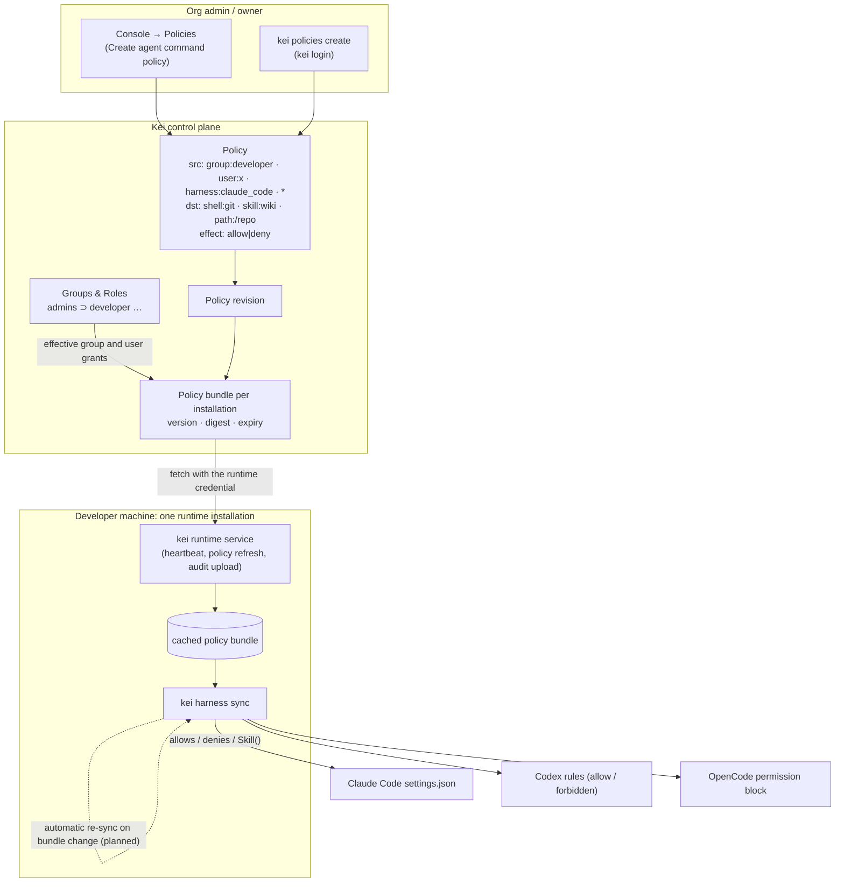
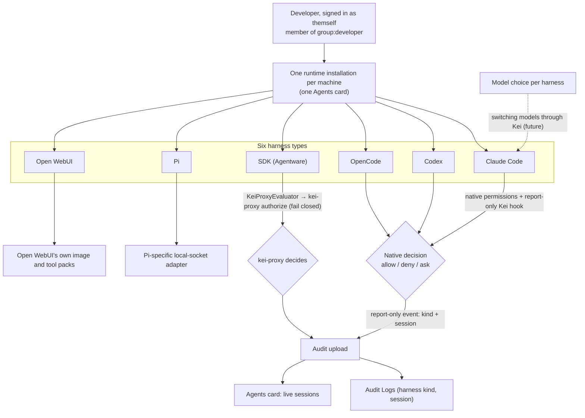

# How Kei governs coding agents

Kei supports six harness types: Claude Code, Codex, OpenCode, Pi, Open WebUI, and SDK (Agentware). Claude Code, Codex, and OpenCode are desktop harnesses; Pi uses its own package and local-socket adapter; Open WebUI uses its own integration; other agents integrate through the Agentware SDK. Each developer machine has one runtime installation, and each harness session is associated with it. Kei renders eligible command policies into desktop editor settings; each editor makes its own **native decision** (allow, deny, or ask), and Kei audits the session.

## How policies are created and distributed

- Admins create policy in the console or with the Kei CLI, and Kei records each change as a policy revision.
- Kei distributes a versioned, expiring policy bundle to the machine's single runtime installation.
- `kei harness sync` translates the bundle into native permissions for the installed harnesses.
- The runtime evaluates group, user, and `autogroup:member` policy sources for governed calls. For desktop command policies, a `group:` source renders when it matches one of the bundle subject's groups, and a `user:` source renders when it matches that subject. A non-matching source is skipped; policies for user and group sources are not rendered for other subjects. `autogroup:member` resolves at runtime for every organization member and is never stored. Automatic re-sync is planned, as shown by the dotted arrow.

## Bring your own editor

- One installation supports multiple harnesses and sessions on the same developer machine.
- Supported editors apply eligible Kei-generated native permission settings and make their own native decision (allow, deny, or ask). The audit hook reports activity and does not decide or block calls.
- SDK (Agentware) integrations use `KeiProxyEvaluator` to call `kei-proxy authorize`, which fails closed when it cannot authorize a request. Start with [Build on the agentware SDK](/kei/reference/agentware-sdk).
- Pi and Open WebUI remain separate harness types with their own integrations; see [Pi setup](/kei/connect-your-harness/harness-setup#pi) and [Open WebUI with Kei](/kei/connect-your-harness/openwebui).
- Kei receives audit events with the harness kind and session, and shows activity in Audit Logs and the Agents card.

## What's planned

Kei plans to automatically re-sync harness permissions when a policy bundle changes and to support switching models per harness through Kei. These capabilities are planned and do not have promised release dates.

## Learn more

- [Deterministic guardrails: how Kei compares with other policy models](/kei/reference/deterministic-guardrails)
- [How Kei decides](/kei/reference/how-kei-decides)
- [Harness rendering](/kei/reference/harness-rendering)
- [Connect your agent](/kei/get-started/connect-your-agent)
- [Policies and approvals](/kei/policies/policies-and-approvals)
- [Audit logs](/kei/audit/logs)
