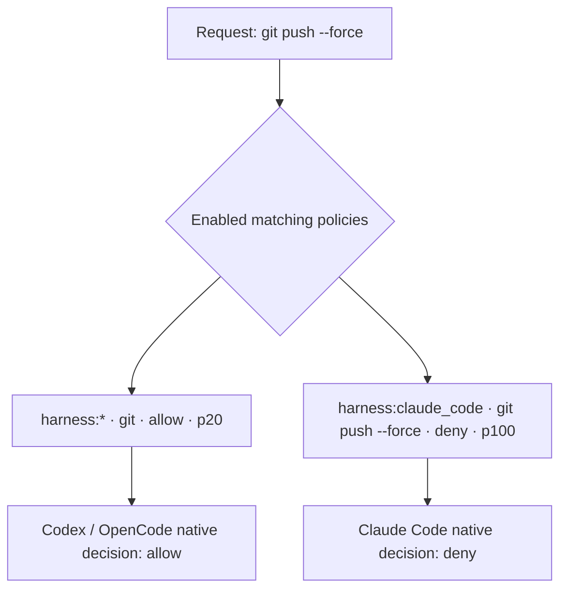
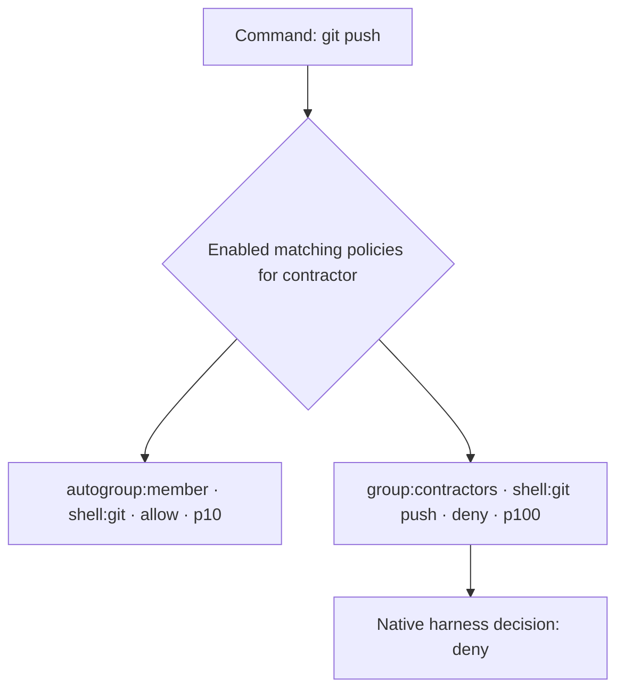
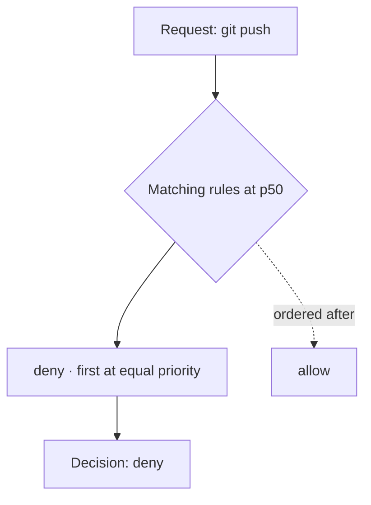
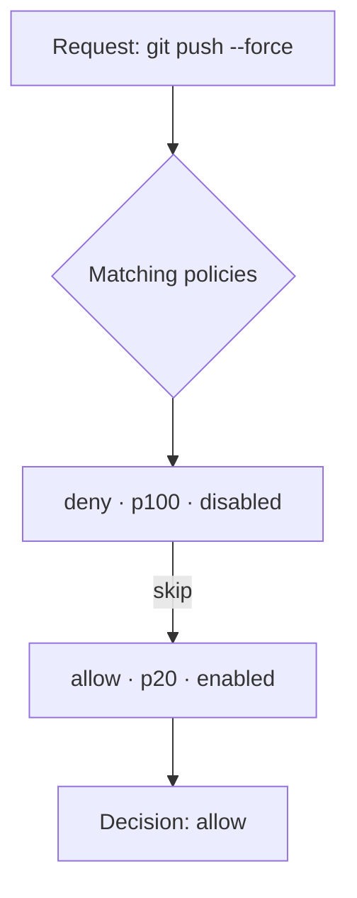
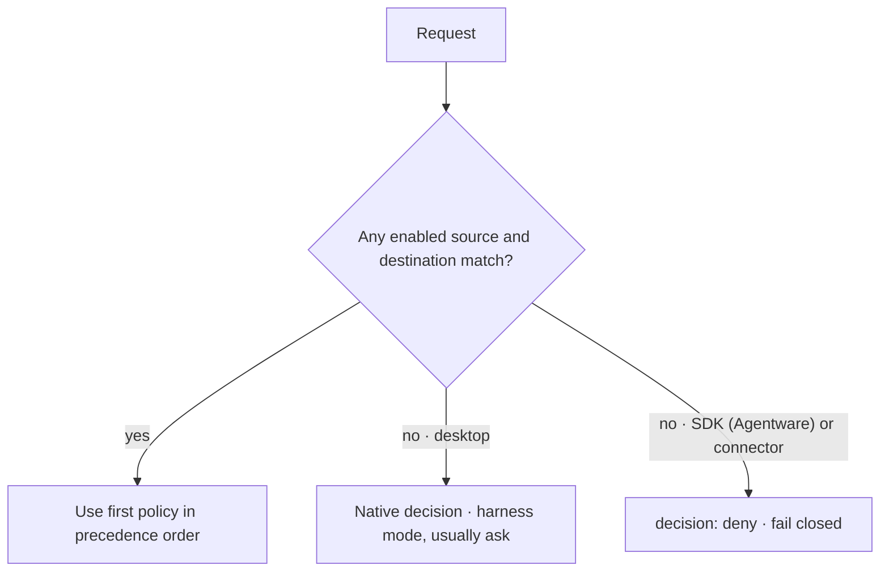

# How Kei decides

This page describes how Kei evaluates policies against a request. It is the single reference for policy precedence. All other pages that mention precedence link here.

## Decision model

Kei uses a **priority-based** evaluation model. When several enabled policies match the same request, the highest-priority policy determines the outcome. If two policies have the same priority, a deny effect wins over an allow. If they also share the same effect, the policy with the lower ID (created earlier) decides.

```
Ordering:
  1. Priority, highest first.
  2. Effect: deny before allow at the same priority.
  3. Policy ID (ascending) as the final tie-breaker.
```

The first policy in that order determines the evaluation decision. If no enabled policy matches:

- **Desktop harness** (Claude Code, Codex, OpenCode): the harness makes its own native decision, usually **ask**.
- **SDK (Agentware)** integration or **connector** operation: the runtime fails closed — the call is denied.

> **Planned: deny-wins.** A planned change will remove priorities and decide solely by deny-wins: any matching deny overrides every matching allow, regardless of order. This page describes today's priority-based model.

### Effect values

The UI and documentation use **Allow** and **Deny**. The API and CLI accept `permit` as the stored value for an allow.

| Display | API / CLI value |
| ------- | --------------- |
| Allow   | `permit`        |
| Deny    | `deny`          |

## Anatomy of a policy

Each policy has a source (`src`), destination (`dst`), effect, priority, and enabled state.

| Field     | What it means | Examples |
| --------- | ------------- | -------- |
| `src`     | Who the policy applies to: `*`, `user:<id>`, `email:<address>`, `group:<name>`, `org:<role>`, `agent:<id>`, `harness:<kind>`, or `autogroup:<name>` | `group:developers`, `harness:claude_code`, `autogroup:member` |
| `dst`     | What it matches: `*`, `shell:<prefix>`, `skill:<name>`, `path:<glob>`, `capability:<name>`, `connector:<id>`, `tool:<name>`, or `mcp:<name>` | `shell:git push`, `skill:wiki`, `path:/repo/**`, `capability:pull_request.read`, `connector:issues-service` |
| `effect`  | The outcome if the policy decides: **allow** (`permit`) or **deny** (`deny`) | `deny` |
| `priority` | An integer weight. A higher number wins. | `100` |
| `enabled` | Whether the policy participates in a decision | `true` or `false` |

- `*` as a source matches any principal. `*` as a target matches any destination.
- `user:<id>` uses the stable Kei user ID. `email:<address>` is a legacy source form matched against the email associated with that resolved user — never an email supplied by the caller.
- Groups are scoped to a workspace. Members inherit policies from groups the group nests; cycles are rejected, and the maximum nesting depth is bounded.

## How policies are collected and ordered

For a request, Kei:

1. Collects enabled policies whose source applies and whose destination matches the requested target.
2. Orders them by priority (descending), then effect (deny before allow), then policy ID (ascending).
3. The first policy in that order decides.

For `kei-proxy authorize`, the runtime evaluates its current, verified, versioned policy bundle locally. If the bundle expires or cannot be validated, the runtime fails closed.

Desktop shell, skill, and path policies render into local harness settings. When no rendered rule matches, the harness makes its own native decision. The audit hook reports activity; it does not make a decision or block a call.

### Capability AND semantics

A tool call can declare `required_capabilities`. Every required capability must have an allow decision for the tool call to proceed. Precedence is evaluated separately for each capability, and the combined result is allow only when every required capability is allowed. A tool-call allow never overrides a deny effect on one of those capabilities.

## Matching rules

| Target kind | Matching rule |
| ----------- | ------------- |
| `shell:<prefix>` | Whole-token argv prefix. `shell:git` matches `git push`, but not `gitx`. Each policy token must match the corresponding command token exactly. No quoting, escaping, or partial-token slash match. |
| `path:<glob>` | Glob for an absolute, lexically cleaned path. `*` matches within one segment; `**` as a whole segment matches zero or more segments. `path:/repo/**` matches paths under `/repo`. |
| `skill:<name>` | Exact name. `skill:wiki` matches `wiki`, not `wiki-admin`. |
| `tool:<name>` | Exact tool-call name, no wildcards, no `:` inside the name. `tool:registered_function` matches only the named registered tool call. |
| `capability:<name>` | Exact capability name, no wildcards. `capability:pull_request.read` matches only that capability. |
| `connector:<id>` | Exact connector ID. `connector:*` matches any non-empty connector ID. A `*` inside a name is literal — `connector:issues.*` matches that literal ID, not every connector beginning with `issues`. |
| `mcp:<name>` | Exact MCP server name. |

## Worked examples

### A. A narrow deny overrides a broad allow

| Source | Destination | Effect | Priority |
| ------ | ----------- | ------ | -------: |
| `harness:*` | `shell:git` | allow | 20 |
| `harness:claude_code` | `shell:git push --force` | deny | 100 |

The higher-priority, harness-specific deny blocks `git push --force` on Claude Code. The broad `harness:*` allow still applies to other harnesses for `git` commands.



### B. A group-specific deny overrides a member baseline

| Source | Destination | Effect | Priority |
| ------ | ----------- | ------ | -------: |
| `autogroup:member` | `shell:git` | allow | 10 |
| `group:contractors` | `shell:git push` | deny | 100 |

Every organization member can run `git` commands. Members of the contractors group have the higher-priority deny that blocks `git push`. Other members can still push.



### C. Deny wins an equal-priority tie

| Source | Destination | Effect | Priority |
| ------ | ----------- | ------ | -------: |
| `harness:*` | `shell:git push` | allow | 50 |
| `harness:*` | `shell:git push` | deny | 50 |

Both rules have priority 50, but deny is ordered first and decides the request.



### D. Disabled rules are skipped

| Source | Destination | Effect | Priority | Enabled |
| ------ | ----------- | ------ | -------: | ------- |
| `harness:*` | `shell:git push --force` | deny | 100 | no |
| `harness:*` | `shell:git` | allow | 20 | yes |

The disabled deny does not participate. The enabled allow at priority 20 is the first matching rule and decides.



### E. No match uses the harness default or fails closed

| Request | Matching policy | Result |
| ------- | --------------- | ------ |
| `shell:deploy-prod` on Claude Code | None | Native decision from Claude Code's configured mode, usually ask |
| `connector:billing.charge` through a connector | None | `deny` decision (fail closed) |



## Choosing priorities

**Recommended convention** (a suggestion, not enforced):

| Layer | Priority | Example |
| ----- | -------- | ------- |
| Guardrail denies | 100 | `shell:git push --force` deny |
| Harness-wide allows | 50 | `shell:git` allow for `harness:*` |
| Role or group allows | 20 | `shell:git log` allow for `group:junior-devs` |
| Baseline | 10 | `shell:git` allow for `autogroup:member` |

Leave gaps between layers so you can insert rules later. When the order matters, give each rule a distinct priority instead of relying on the policy ID tie-breaker.

## Where precedence is visible

- **Policies list:** switch to the group view to see rules in precedence order. An `except` note shows a narrower rule that changes where a broader rule applies. `Never applies` means a winning rule always supersedes that rule for its match. When the override is harness-scoped, the note names the harness.
- **Group detail:** the **Effective** tab shows inherited and direct policies in effective precedence order.
- **Audit Logs:** **Decided by** identifies the winning policy, and **Outranked** lists matching policies that lost or were disabled.

## Learn more

- [Policy file syntax](/kei/reference/policy-file-syntax) — source and target scheme reference
- [Autogroups](/kei/reference/autogroups) — how `autogroup:` sources resolve at runtime
- [Harness rendering](/kei/reference/harness-rendering) — how Kei renders rules into each harness
- [Tools and capabilities](/kei/reference/tools-and-capabilities) — `required_capabilities` and capability-target semantics
- [Deterministic guardrails](/kei/reference/deterministic-guardrails) — how Kei compares with other policy models
- [How Kei governs coding agents](/kei/reference/how-it-works) — policy distribution and architecture overview
