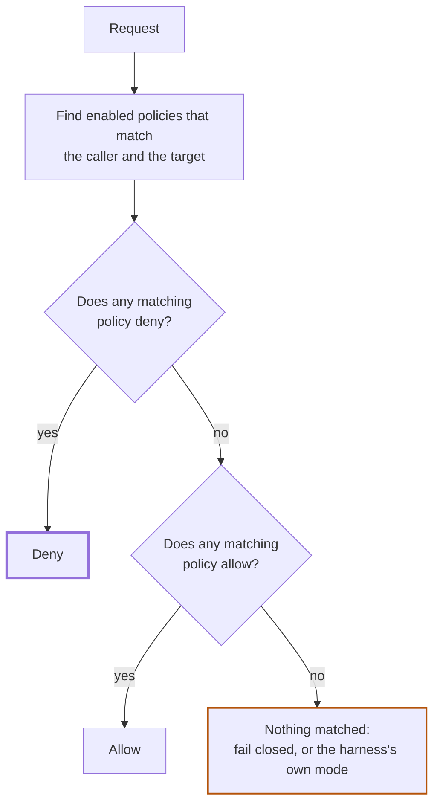
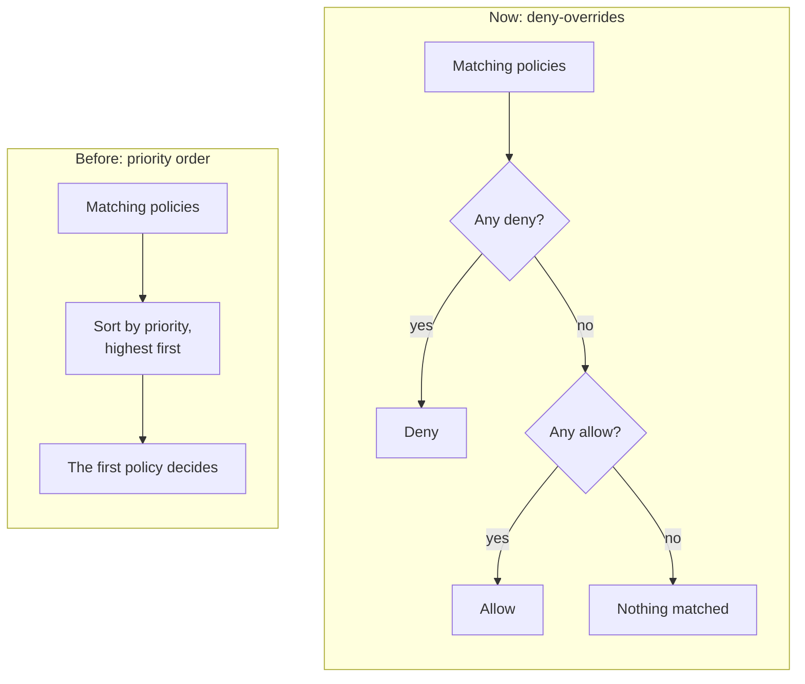
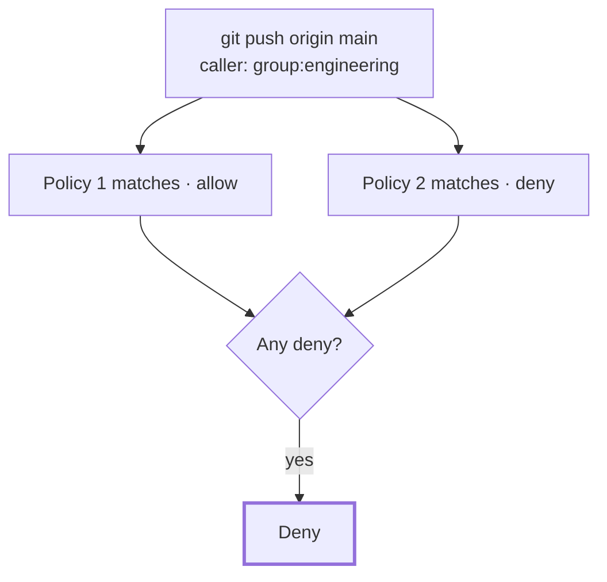
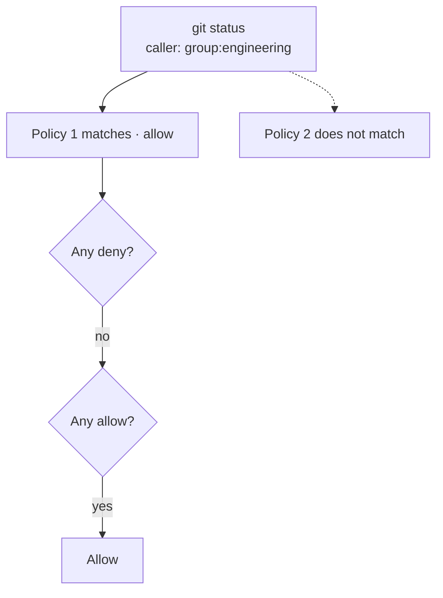
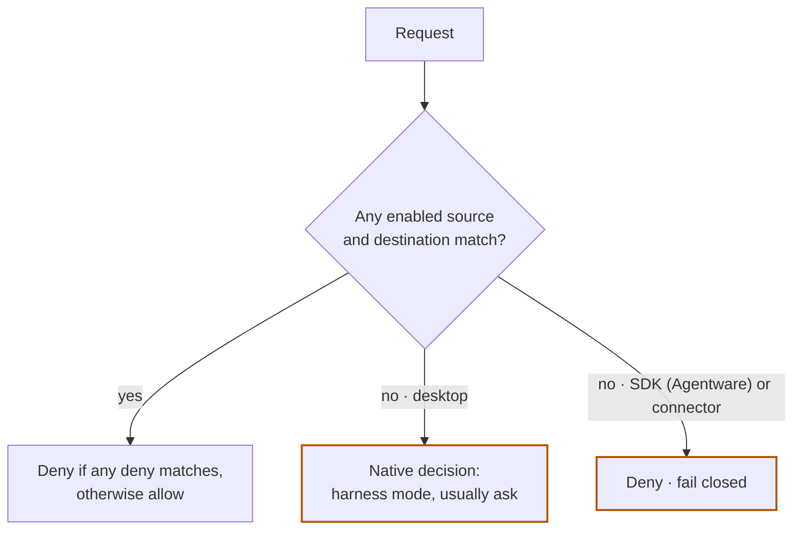

# How Kei decides

This page describes how Kei evaluates policies against a request. It is the single reference for policy precedence. All other pages that mention precedence link here.

## Decision model

Kei uses **deny-overrides**. When several enabled policies match the same request, any matching deny decides the outcome, no matter how many allows also match and no matter the order the policies were created or listed in. If no policy denies and at least one allow matches, the request is allowed. If nothing matches, the request fails closed or uses the harness's own mode (see below).

The rule has three steps, in this order:

1. If any enabled matching policy has the **deny** effect, the decision is deny.
2. Otherwise, if any enabled matching policy has the **allow** effect, the decision is allow.
3. Otherwise nothing matched:
   - **Desktop harness** (Claude Code, Codex, OpenCode): the harness makes its own native decision, usually **ask**.
   - **SDK (Agentware)** integration or **connector** operation: the runtime fails closed, and the call is denied.

Policies have no priority, so there is nothing to tune and no ordering to get wrong. To carve an exception out of a broad allow, add a narrower **deny**. To lift a deny, remove or disable it.

### From priorities to deny-overrides

Earlier versions ordered matching policies by an integer priority, so a high-priority allow could beat a low-priority deny. Deny-overrides removes that case: an allow can never override a deny.

| | Before: priority order | Now: deny-overrides |
| --- | --- | --- |
| What picks the winner | The highest-priority matching policy | Any matching deny |
| Can an allow beat a deny? | Yes, if its priority is higher | No |
| Does creation order matter? | It broke ties between equal policies | No |
| What you maintain | A priority number on every policy | Nothing: just allows and denies |

> **Note:** The Kei policy service no longer reads priority, and the console no longer shows a priority input or column. Existing API and CLI clients that still send `priority` keep working: the value is accepted and ignored. Runtimes decide with deny-overrides starting with the kei-proxy release that ships it; the policy bundle declares it only to runtimes that accept it. Until a runtime is on that release, it keeps its earlier decision code, so update `kei-proxy` to get the new behavior on that machine.

### Effect values

The UI and documentation use **Allow** and **Deny**. The API and CLI accept `permit` as the stored value for an allow.

| Display | API / CLI value |
| ------- | --------------- |
| Allow   | `permit`        |
| Deny    | `deny`          |

## Anatomy of a policy

Each policy has a source (`src`), destination (`dst`), effect, and enabled state.

| Field     | What it means | Examples |
| --------- | ------------- | -------- |
| `src`     | Who the policy applies to: `*`, `group:<name>` (or a bare group name), `harness:<kind>`, or `autogroup:member` / `autogroup:admin`. Custom groups hold users, agents, and service principals | `group:developers`, `harness:claude_code`, `autogroup:member` |
| `dst`     | What it matches: `*`, `shell:<prefix>`, `skill:<name>`, `path:<glob>`, `capability:<name>`, `connector:<id>`, `tool:<name>`, or `mcp:<name>` | `shell:git push`, `skill:wiki`, `path:/repo/**`, `capability:pull_request.read`, `connector:issues-service` |
| `effect`  | The outcome if the policy decides: **allow** (`permit`) or **deny** (`deny`) | `deny` |
| `enabled` | Whether the policy participates in a decision | `true` or `false` |

- `*` as a source matches any principal. `*` as a target matches any destination.
- A policy names groups, not individuals. A direct subject appears only in an access grant, by ID; a policy never names an email address, and organization role is not a policy source. See [Who a policy can name](/kei/reference/policy-file-syntax#who-a-policy-can-name).
- Groups are scoped to a workspace. Members inherit policies from groups the group nests; cycles are rejected, and the maximum nesting depth is bounded.

## How policies are collected and decided

For a request, Kei:

1. Collects enabled policies whose source applies and whose destination matches the requested target.
2. Denies if any collected policy is a deny.
3. Otherwise allows if any collected policy is an allow.
4. Otherwise applies the no-match behavior described above.

For `kei-proxy authorize`, the runtime evaluates its current, verified, versioned policy bundle locally. If the bundle expires or cannot be validated, the runtime fails closed.

Desktop shell, skill, and path policies render into local harness settings. When no rendered rule matches, the harness makes its own native decision. The audit hook reports activity; it does not make a decision or block a call.

### Capability AND semantics

A tool call can declare `required_capabilities`. Every required capability must have an allow decision for the tool call to proceed. Deny-overrides is applied separately for each capability, and the combined result is allow only when every required capability is allowed. A tool-call allow never overrides a deny effect on one of those capabilities.

## Matching rules

| Target kind | Matching rule |
| ----------- | ------------- |
| `shell:<prefix>` | Whole-token argv prefix. `shell:git` matches `git push`, but not `gitx`. Each policy token must match the corresponding command token exactly. No quoting, escaping, or partial-token slash match. |
| `path:<glob>` | Glob for an absolute, lexically cleaned path. `*` matches within one segment; `**` as a whole segment matches zero or more segments. `path:/repo/**` matches paths under `/repo`. |
| `skill:<name>` | Exact name. `skill:wiki` matches `wiki`, not `wiki-admin`. |
| `tool:<name>` | Exact tool-call name, no wildcards, no `:` inside the name. `tool:registered_function` matches only the named registered tool call. |
| `capability:<name>` | Exact capability name, no wildcards. `capability:pull_request.read` matches only that capability. |
| `connector:<id>` | Exact connector ID. `connector:*` matches any non-empty connector ID. A `*` inside a name is literal — `connector:issues.*` matches that literal ID, not every connector beginning with `issues`. |
| `mcp:<name>` | Exact MCP server name. |

## Worked examples

Examples A to D use these two policies unless stated otherwise. Both name a group, never a person.

| Policy | Source | Destination | Effect |
| ------ | ------ | ----------- | ------ |
| 1 | `group:engineering` | `shell:git` | allow |
| 2 | `group:engineering` | `shell:git push` | deny |

`shell:git` matches any command that starts with the token `git`, so it covers `git status`, `git log`, and `git push`. `shell:git push` matches only commands that start with `git push`.

### A. A request that matches both: denied

A member of `group:engineering` runs `git push origin main`. Policy 1 matches, and policy 2 matches. One of the matches is a deny, so the decision is **deny**. It does not matter that an allow also matches.

### B. A request that matches only the allow: allowed

The same member runs `git status`. Policy 1 matches. Policy 2 does not, because `git status` does not start with `git push`. No matching policy denies, and one allows, so the decision is **allow**.

### C. A request that matches nothing: fails closed

An agent calls the connector operation `connector:billing.charge`, and no policy names it. Nothing matches, so there is no allow to find. A connector or SDK (Agentware) call is **denied** (fail closed). A desktop harness command that matches nothing uses the harness's own mode instead, usually ask.

| Request | Matching policy | Result |
| ------- | --------------- | ------ |
| `shell:deploy-prod` on Claude Code | None | Native decision from Claude Code's configured mode, usually ask |
| `connector:billing.charge` through a connector | None | `deny` decision (fail closed) |

### D. A deny scoped to one group: only that group is affected

Add a third policy:

| Policy | Source | Destination | Effect |
| ------ | ------ | ----------- | ------ |
| 3 | `autogroup:member` | `shell:git` | allow |
| 4 | `group:contractors` | `shell:git push` | deny |

Every organization member can run `git` commands. A member who is also in `group:contractors` matches policy 4, so `git push` is denied for them. Other members, who do not match policy 4, can still push.

### E. Disabled policies are skipped

Disable policy 2. A disabled policy does not participate, so `git push origin main` now matches only policy 1 and is **allowed**. Re-enable the deny and the same request is denied again.

### F. Order does not matter

Policies 1 and 2 give the same results whether policy 2 was created first, last, or in between. Reordering, duplicating an allow, or adding more allows never changes a denied request into an allowed one.

## Where precedence is visible

- **Policies list:** switch to the group view. An `except` note shows a narrower rule that changes where a broader rule applies. `Never applies` means a matching deny always supersedes that rule for its match. When the override is harness-scoped, the note names the harness.
- **Group detail:** the **Effective** tab shows inherited and direct policies.
- **Audit Logs:** **Decided by** identifies the policy that decided, and **Outranked** lists matching policies that lost or were disabled.

## Learn more

- [Policy file syntax](/kei/reference/policy-file-syntax) — source and target scheme reference
- [Autogroups](/kei/reference/autogroups) — how `autogroup:` sources resolve at runtime
- [Harness rendering](/kei/reference/harness-rendering) — how Kei renders rules into each harness
- [Tools and capabilities](/kei/reference/tools-and-capabilities) — `required_capabilities` and capability-target semantics
- [Deterministic guardrails](/kei/reference/deterministic-guardrails) — how Kei compares with other policy models
- [How Kei governs coding agents](/kei/reference/how-it-works) — policy distribution and architecture overview
